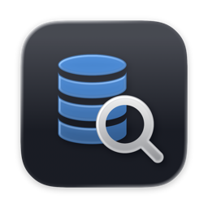
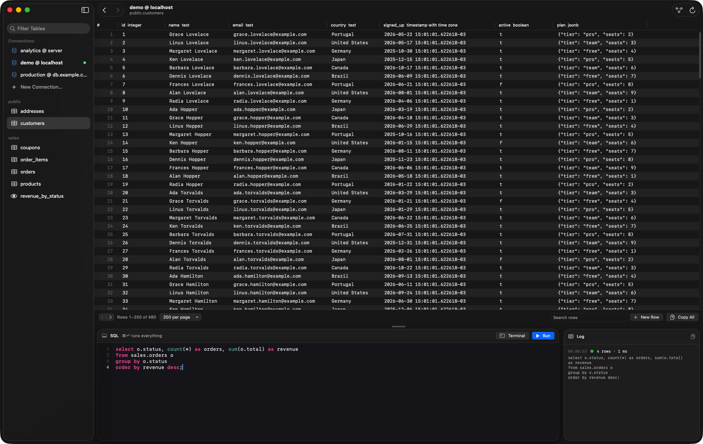
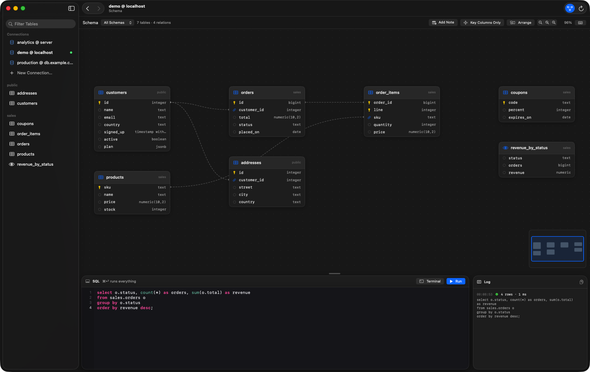
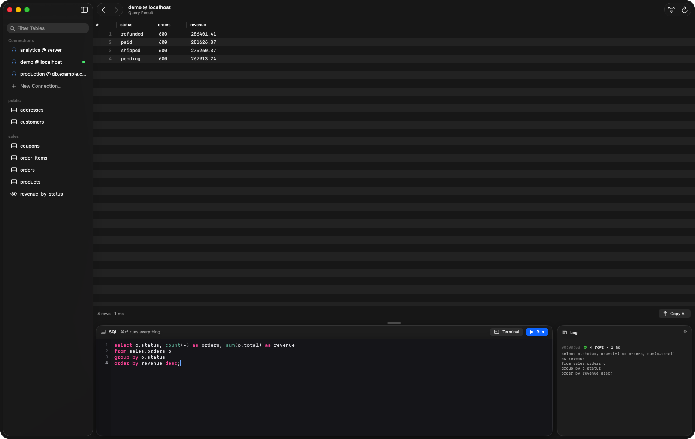

<p align="center">
  
</p>

<h1 align="center">dbLens</h1>

<p align="center">
  A light, simple, AI-ready database client for the Mac, Windows and Linux.<br>
  Paste a URL, click a table, see the rows. Or let your agent do it.
</p>

<p align="center">
  
</p>

Most database tools are slow, heavy, and full of things you never use. dbLens stands on
three things:

- **Light.** A small app that opens in a blink and stays fast on tables of millions of rows.
- **Simple.** It does the few things you do every day, with no trees, wizards, or menus
  to dig through.
- **AI-ready.** Built-in MCP server: Claude Code, Claude Desktop, Cursor, and other agents
  explore schemas, query, and manage your databases through the connections saved in
  dbLens, without ever seeing a URL or password. Read-only by default; writing is a switch
  per connection. [How it works](#mcp-server-for-agents).

**Databases:** PostgreSQL, MySQL and MariaDB, SQLite, Redis (and Valkey), and MongoDB. Paste the
URL, and dbLens tells which database it is.

- **Paste any connection string and connect.** dbLens reads the kind of database from it
  and shows it as a tag; no menus to pick from. MySQL: `mysql://`, `mariadb://`,
  `jdbc:mysql://`, SQLAlchemy's `mysql+pymysql://`, `?ssl-mode=`. SQLite: a file path,
  `sqlite:///path`, or `file:`. Postgres: `postgres://`, `postgresql://`,
  `jdbc:postgresql://`, SQLAlchemy (`postgresql+psycopg2://`), a whole `.env` line
  (`DATABASE_URL="…"`), Prisma's `?schema=`, several hosts, Unix sockets, or libpq's
  `host=… dbname=…` form. Or fill in host, port, user, and password.
- **Click a table, see its rows.** No tree to expand, no "View Data" menu. Scroll through
  the whole table (rows are read in blocks as you go), sorted by the primary key or by any column you click, with column
  types in the header. Search finds text in any column across every page, on the server.
  Export the whole table, or a query result, as CSV or JSON.
- **Edit in place.** Double-click a cell, type, press Return. Edits use the primary key
  (or `ctid`), run in a transaction, and roll back if they would touch more than one row.
  Add and delete rows, set `NULL`, copy rows or the whole grid as tab-separated text.
- **Run SQL.** A code editor with line numbers, syntax colors, and suggestions for your
  tables and columns, in a panel you can fold away (⇧⌘Y). ⌘↩ runs the selection or
  everything; the result shows in the same grid. History keeps what you ran on each
  connection, a double-click away from running again.
- **Redis without a manual.** `redis://` or `rediss://`: keys grouped by prefix, each value
  shown by type (strings, hashes, lists, sets, sorted sets, streams) with its TTL, edited in
  place, and a command panel that runs one command per line.
- **MongoDB like a table.** `mongodb://` or `mongodb+srv://`: collections in the sidebar,
  documents in the grid with each field's type, nested values as JSON, edits that keep a
  field's type, and a query panel that speaks mongosh (`db.users.find({plan: "pro"})`,
  `aggregate`, `insertOne`, `updateMany`, `use`, `show collections`).
- **See the schema.** A board of every table with its columns and foreign keys: drag the
  cards and the board, zoom at the pointer, add sticky notes and colors, find your way
  with the minimap, double-click a card to open its rows (⌘3).
- **Back and Forward.** ⌘[ and ⌘] walk everything you looked at: tables, pages, query
  results, the board, even across connections.
- **Open in Terminal (⇧⌘T).** For scripts and everything else, the database's own client —
  psql, mysql, sqlite3, redis-cli, mongosh — opens connected, through the same SSH tunnel.
  Passwords go in the client's environment variable, not on the command line (mongosh has none).
- **SSH tunnels built in.** Uses your Mac's own `ssh`, keys, agent, and `~/.ssh/config`,
  and reconnects by itself when the tunnel drops.
- **Passwords stay private.** Saved connection URLs are encrypted with AES-GCM under a key
  kept in your system's keychain, and saved passwords never show on screen.
- **Light and dark.** Follows the system, or pick one, with twelve accent colors.

- **For agents, too.** `dbLens --mcp` is an MCP server: Claude Code, Claude Desktop, or
  Cursor read your databases through the connections saved here, without ever seeing a
  URL or password. Queries are read-only, enforced by the database. Writing is off until
  you turn on **Let Agents Write** for a connection. [More below](#mcp-server-for-agents).

<p align="center">
  
  
</p>

## Install

From [Releases](../../releases):

| System | File |
| --- | --- |
| macOS 13 or later (Apple silicon and Intel) | `dbLens-x.y.z.dmg`: open it and drag **dbLens** to Applications. Signed and notarized by Apple. |
| Windows 10 and 11 | `dbLens_x.y.z_x64-setup.exe` or `dbLens_x.y.z_x64_en-US.msi` |
| Linux (x86_64) | `.deb` (Debian, Ubuntu), `.rpm` (Fedora), or `.AppImage` (any) |

Or on the Mac: `brew install --cask miguelplaza17/tap/dblens`. dbLens updates itself.

**Coming from the old Mac app (1.4 and earlier)?** It updates itself to this one. On the
first launch dbLens brings your connections, folders, SQL history and settings over by
itself. Keep `~/Library/Application Support/dbLens/` until you see them; after that it can go.

## Build from source

dbLens is built with [Tauri 2](https://tauri.app) (Rust + React) in [`desktop/`](desktop/):

```bash
git clone https://github.com/miguelplaza17/dbLens.git
cd dbLens/desktop
npm install && npm run tauri build
```

Requirements, tests, releasing and status are in [desktop/README.md](desktop/README.md).
The SwiftUI app that was dbLens for the Mac until 1.4 is still in the repository root
(`./build.sh`, `tools/release-swift.sh`), no longer released.

## MCP server (for agents)

dbLens's own app is also an [MCP](https://modelcontextprotocol.io) server. Agents pick a
connection by name; dbLens opens it with the URL it keeps encrypted, through the same SSH
tunnel, so the agent never sees a password.

```bash
claude mcp add dblens -- /Applications/dbLens.app/Contents/MacOS/dbLens --mcp
```

Claude Desktop and Cursor take the same command in their MCP settings:

```json
{ "mcpServers": { "dblens": { "command": "/Applications/dbLens.app/Contents/MacOS/dbLens", "args": ["--mcp"] } } }
```

| Tool | What it does |
| --- | --- |
| `list_connections` | Saved connections: name, engine, SSH, whether agents may write. Never the URL. |
| `create_connection` | Saves a new connection from its URL after checking it (optionally through SSH), encrypted like the app's. Starts read-only. Only with Settings > Agents > **Let agents add and remove connections**. |
| `delete_connection` | Removes a saved connection and its history; the database itself is untouched. Same setting. |
| `list_tables` | Tables and views (Redis keys, MongoDB collections) with estimated rows. |
| `describe_schema` | The whole structure at once: every table with its columns, keys, and foreign keys. |
| `describe_table` | Columns, types, primary key, foreign keys, and the tables that reference it. |
| `list_extensions` | What the database adds to plain SQL: PostgreSQL extensions (installed and available), MySQL plugins, SQLite compile options, Redis modules, with the server version. |
| `install_extension` | Installs an available PostgreSQL extension, only where agents may write. |
| `query` | One read-only statement. PostgreSQL and MySQL run it in a read-only transaction, SQLite only if it changes nothing, MongoDB and Redis only reading methods and commands. |
| `test_changes` | Tries a change or a whole migration in a transaction that is always rolled back, and reports what each statement did or which one failed. PostgreSQL and SQLite: data and DDL; MySQL: data only (its DDL commits by itself). |
| `execute` | Changes data or schema for real, only where you turned on **Let Agents Write** (right-click the connection, or Settings > Agents). Scripts run all or nothing where the database allows; otherwise the result says what that means. |

Everything an agent runs shows in the connection's History in the SQL panel, marked
"via agent". `tools/mcp-test.sh` drives every tool against a throwaway Postgres.

`.claude/skills/dblens-mcp/SKILL.md` is a skill that teaches agents the safe order of the
tools: look before reading, rehearse with `test_changes`, and confirm before `execute`.
Copy it to `~/.claude/skills/` to use it in every project.

## Where things are kept

| What | Where |
| --- | --- |
| Saved connections (URLs encrypted) and SQL history | macOS: `~/Library/Application Support/app.dblens.dbLens/`; Windows: `%APPDATA%\dblens\dbLens\data\`; Linux: `~/.local/share/dblens/` |
| The key for the URLs | the system keychain (Keychain on macOS, Credential Manager on Windows, Secret Service on Linux), or a file readable only by you where there is none |

## Languages

English and Brazilian Portuguese. Translations live in `desktop/src/i18n/<language>.json`;
adding one is a single file.

## Contributing

Issues and pull requests are welcome. dbLens stays small on purpose: new features should
make the everyday path faster, not add menus. `CLAUDE.md` describes the layout, the build,
and the design rules.

## License

dbLens is [MIT](LICENSE). The app bundles these client libraries, each under its own license:
libpq (PostgreSQL License), Sparkle (MIT), MariaDB Connector/C (LGPL-2.1, linked dynamically and
replaceable in `Contents/Frameworks`), the MongoDB C driver and libbson (Apache-2.0),
zstd (BSD), OpenSSL (Apache-2.0), MIT Kerberos (MIT), and GNU
gettext's libintl (LGPL-2.1). SQLite is the one that ships with macOS.
