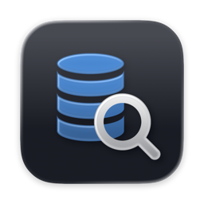
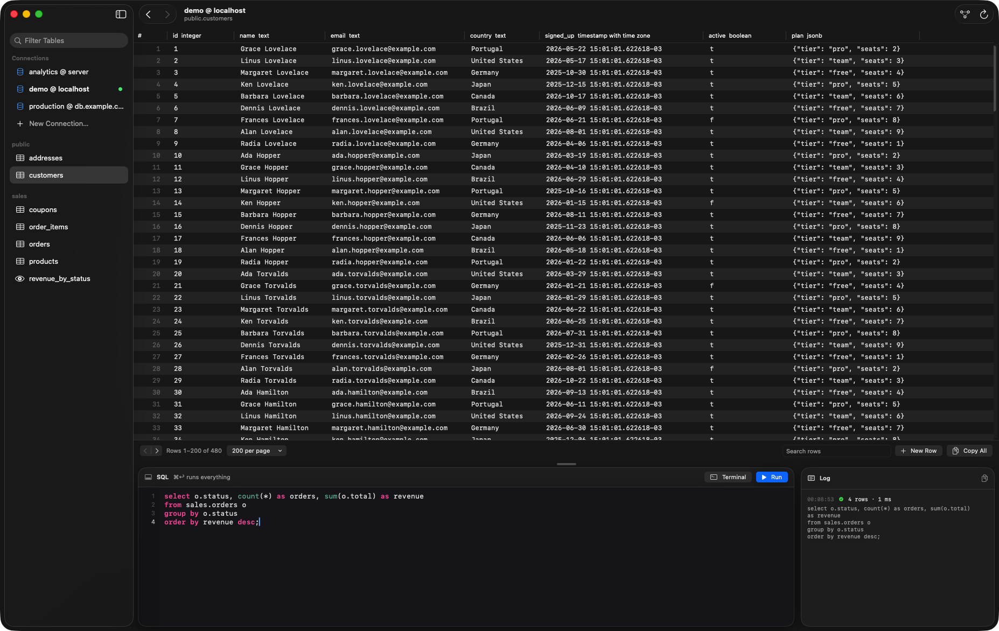
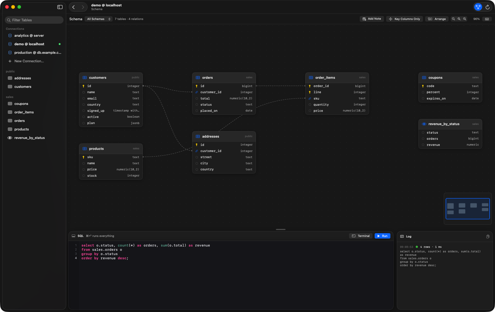
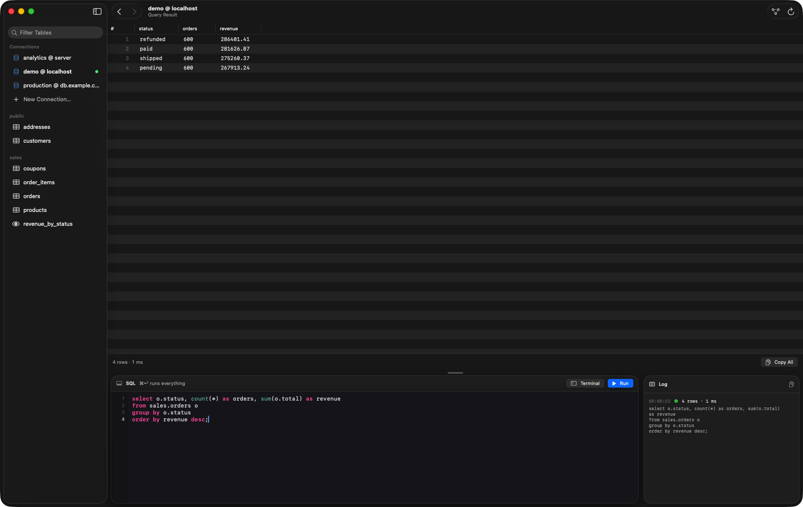

<p align="center">
  
</p>

<h1 align="center">dbLens</h1>

<p align="center">
  A fast, minimal database client for the Mac.<br>
  Paste a URL, click a table, see the rows. That's it.
</p>

<p align="center">
  
</p>

Most database tools are slow, heavy, and full of things you never use. dbLens does the
few things you do every day, and does them instantly.

**Databases:** PostgreSQL, MySQL and MariaDB, SQLite, Redis (and Valkey), and MongoDB. Paste the
URL, and dbLens tells which database it is.

- **Paste any connection string and connect.** dbLens reads the kind of database from it
  and shows it as a tag; no menus to pick from. MySQL: `mysql://`, `mariadb://`,
  `jdbc:mysql://`, SQLAlchemy's `mysql+pymysql://`, `?ssl-mode=`. SQLite: a file path,
  `sqlite:///path`, or `file:`. Postgres: `postgres://`, `postgresql://`,
  `jdbc:postgresql://`, SQLAlchemy (`postgresql+psycopg2://`), a whole `.env` line
  (`DATABASE_URL="…"`), Prisma's `?schema=`, several hosts, Unix sockets, or libpq's
  `host=… dbname=…` form. Or fill in host, port, user, and password.
- **Click a table, see its rows.** No tree to expand, no "View Data" menu. Pages of
  50 to 1,000 rows, sorted by the primary key, with column types in the header. Search
  finds text in any column across every page, on the server.
- **Edit in place.** Double-click a cell, type, press Return. Edits use the primary key
  (or `ctid`), run in a transaction, and roll back if they would touch more than one row.
  Add and delete rows, set `NULL`, copy rows or the whole grid as tab-separated text.
- **Run SQL.** A code editor with line numbers and syntax colors in a panel you can fold
  away (⇧⌘Y). ⌘↩ runs the selection or everything; the result shows in the same grid.
- **Redis without a manual.** `redis://` or `rediss://`: keys grouped by prefix, each value
  shown by type (strings, hashes, lists, sets, sorted sets, streams) with its TTL, edited in
  place, and a command panel that runs one command per line.
- **MongoDB like a table.** `mongodb://` or `mongodb+srv://`: collections in the sidebar,
  documents in the grid with each field's type, nested values as JSON, edits that keep a
  field's type, and a query panel that speaks mongosh (`db.users.find({plan: "pro"})`,
  `aggregate`, `insertOne`, `updateMany`, `use`, `show collections`).
- **See the schema.** A board of every table with its columns and foreign keys: drag the
  cards and the board, zoom at the pointer, add sticky notes and colors, find your way
  with the minimap, double-click a card to open its rows (⌘3).
- **Back and Forward.** ⌘[ and ⌘] walk everything you looked at: tables, pages, query
  results, the board, even across connections.
- **Open in Terminal (⇧⌘T).** For scripts and everything else, the database's own client —
  psql, mysql, sqlite3, redis-cli, mongosh — opens connected, through the same SSH tunnel.
  Passwords go in the client's environment variable, not on the command line (mongosh has none).
- **SSH tunnels built in.** Uses your Mac's own `ssh`, keys, agent, and `~/.ssh/config`,
  and reconnects by itself when the tunnel drops.
- **Passwords stay private.** Saved connection URLs are encrypted with AES-GCM under a key
  bound to your Mac's Secure Enclave, and saved passwords never show on screen.
- **Native and light.** SwiftUI and AppKit, about 12 MB, opens in a blink. Dark only.

<p align="center">
  
  
</p>

## Install

Download the latest `dbLens-x.y.z.dmg` from [Releases](../../releases), open it, and drag
**dbLens** to Applications. It is signed and notarized by Apple.

Requirements: macOS 26 or later on Apple silicon.

## Build from source

```bash
brew install postgresql@16 mariadb-connector-c mongo-c-driver   # client libraries, bundled into the app
git clone https://github.com/miguelplaza17/dbLens.git
cd dbLens
./build.sh --open                # builds, installs ~/Applications/dbLens.app, opens it
```

The project is a Swift package (no Xcode project). `build.sh` builds with SwiftPM, copies
libpq and its libraries into the app (`tools/bundle_libs.sh`), adds the translations, and
signs it with your certificate or ad hoc.

Tests:

```bash
swift test --scratch-path ~/Library/Developer/dbLens/test-build
# The in-app self-test needs a throwaway database (it creates and drops a table):
DBLENS_TEST_URL=postgres://user@localhost/scratch tools/selftest.sh
# Optional, for throwaway servers: DBLENS_TEST_MYSQL_URL=mysql://… DBLENS_TEST_MARIADB_URL=mysql://…
#   DBLENS_TEST_REDIS_URL=redis://… DBLENS_TEST_VALKEY_URL=redis://… DBLENS_TEST_MONGO_URL=mongodb://…
```

Releases: `tools/release.sh` signs with a Developer ID certificate, notarizes, staples,
makes the DMG, and writes the Sparkle appcast; upload both to the GitHub release. The app
checks that appcast once a day (and from **dbLens > Check for Updates…**) and installs an
update only when its signature matches the key in `Info.plist.in`. The steps it needs once are at the top of the script.

## Where things are kept

| What | Where |
| --- | --- |
| Connection names and SSH settings | `~/Library/Application Support/dbLens/dbLens.store` |
| Connection URLs, encrypted | `~/Library/Application Support/dbLens/connections.enc` |
| The Secure Enclave key reference | `~/Library/Application Support/dbLens/connections.key` |

Both files are readable only by your user. The key only works on the Mac that made it: if
you move to a new Mac or reinstall macOS, paste your connection URLs again.

## Languages

English and Brazilian Portuguese. Translations live in `Localization/<language>.json`;
adding one is a single file.

## Contributing

Issues and pull requests are welcome. dbLens stays small on purpose: new features should
make the everyday path faster, not add menus. `CLAUDE.md` describes the layout, the build,
and the design rules.

## License

dbLens is [MIT](LICENSE). The app bundles these client libraries, each under its own license:
libpq (PostgreSQL License), Sparkle (MIT), MariaDB Connector/C (LGPL-2.1, linked dynamically and
replaceable in `Contents/Frameworks`), the MongoDB C driver and libbson (Apache-2.0),
zstd (BSD), OpenSSL (Apache-2.0), MIT Kerberos (MIT), and GNU
gettext's libintl (LGPL-2.1). SQLite is the one that ships with macOS.
